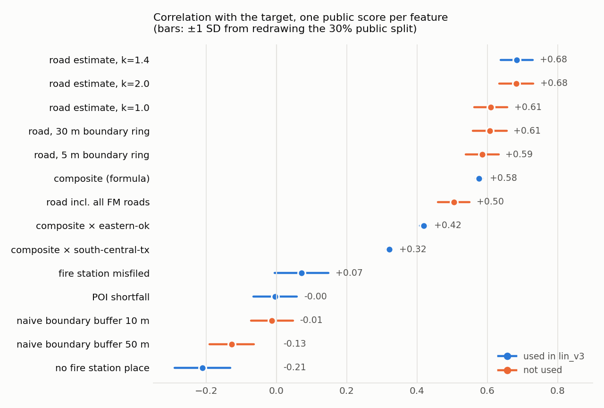
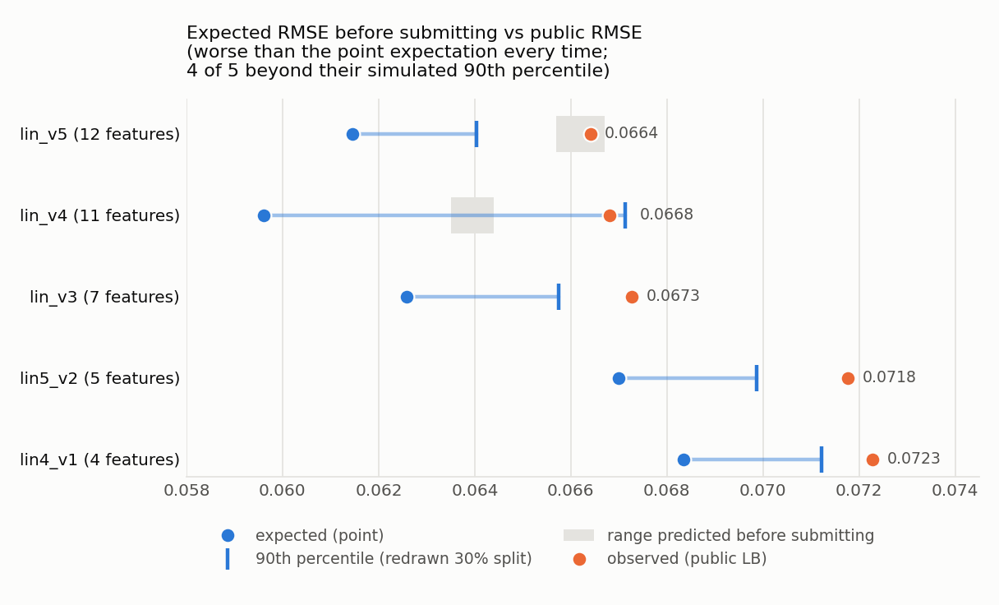

# Bias Bounty: Mapping Equity Challenge — methodology write-up

**Submitted for: Best Documentation and Best Bias Discovery.** Zindi username: as entered on the submission form.

**Leaderboard submissions this write-up describes:** the two final picks, lin_b2yf (submission mMfxzUkA, public RMSE 0.062055); alt_nofac (submission GH4efdZH, public RMSE 0.065236). The Best Bias Discovery part (Part B) uses no leaderboard submission and calibrates none.

**Code and full records:** https://github.com/IwataHiroki0827/bias-bounty-mapping-equity-writeup (one command per part reproduces every number; see A §8 and B "Reproducibility"). The longer versions of both parts are in the repository (`docs/writeup_documentation_draft.md`, `docs/writeup_discovery_draft.md`).

- **Part A — Best Documentation:** estimating the coverage gap after the reference layers were withdrawn.
- **Part B — Best Bias Discovery:** whether a bus stop is on the open map depends on which agency runs the bus.

## Part A — Best Documentation: estimating the coverage gap after the reference layers were withdrawn — a compliant, label-free pipeline

The full record, with every dated step, is in the repository (`docs/writeup_documentation_draft.md`); this version keeps its section numbers.

> **In three lines.** With no labels and the reference layers withdrawn, we used three constant submissions to pin the
> metric (RMSE, not MAE), measured each Overture-only feature's correlation with the target from one aggregate score per
> submission, and combined them by solving the normal equations: public RMSE 0.0634 against 0.0977 for the best constant
> we submitted (the optimal constant would score 0.0890), rebuilt exactly by one script from a log of public scores.
>
> Compliance: no TIGER, Microsoft Building Footprints, HIFLD or CBP data is used anywhere in the scored pipeline. Only
> Overture (release 2026-08-19.0), ACS housing, the strata tables and our own leaderboard probes enter a submission.
> RUCA 2020 (a strata table in the challenge bucket) gives two flags used in the first final pick, lin_b2yf; the
> strata's building-count columns (`usfs_BuildingCount_sum`,
> `carbonplan_buildings`) are not used.

### 1. What changed, and what that leaves

The reference layers were removed on 2026-09-25 and target reconstruction was prohibited on 2026-09-28 (thread 35079).
The task is unsupervised estimation, scored on a 30% public split.

### 2. Pinning down the metric with three constant submissions

The Evaluation page says RMSE; an earlier participant measurement suggested MAE. We submitted constants 0, 0.2 and 0.1:

| constant | public score |
|---:|---:|
| 0.0 | 0.107246299 |
| 0.2 | 0.166070250 |
| 0.1 | 0.097675731 |

If the metric is RMSE, MSE(c) = E[y²] − 2c·E[y] + c². The first two give E[y] = 0.0598 and E[y²] = 0.01150, which
predict 0.09768 for c = 0.1; the third scored 0.097676: **RMSE, confirmed to four digits.** The public target has mean
0.0598, RMS 0.1072 and standard deviation 0.0890, the floor any constant can reach. The daily limit is **5** submissions
(not 10), reset at 00:00 UTC.

### 3. Measuring a feature without labels

Submitting a feature x in [0, 1] returns MSE(x) = E[y²] − 2E[xy] + E[x²], so one submission gives E[xy], hence cov(x, y)
and corr(x, y). Feature–feature covariances are computed locally, so the weights β = Σ⁻¹c and the expected
MSE = var(y) − cᵀΣ⁻¹c follow without any label. Each probe returns one aggregate number; no tract-level value is inferred. Whether fitting weights from one's own public scores is allowed was asked in threads 35292 and 35532 and had no organiser answer by 27 October; every weight in both final picks is fitted this way, so we describe the step in full here rather than assume the answer.

**How reliable is one probe?** We use full-set E[x²] in place of the hidden subset's; over 2,000 redrawn 30% subsets:

| feature | tracts with x > 0 | corr (point) | 95% interval over subsets |
|---|---:|---:|---|
| road proxy (§4) | 18% | +0.610 | [+0.555, +0.662] |
| fire-station misfiled (§5) | 6% | +0.072 | [−0.084, +0.211] |
| POI density shortfall | 75% | −0.004 | [−0.132, +0.117] |

A feature whose interval crosses zero is not accepted or rejected on its own probe.



**Scaled probes remove most of that error.** Submitting a·x gives E[xy] = (E[y²] + a²E[x²] − RMSE²) / 2a, and the error
from full-set moments becomes a/2·ΔE[x²] − ΔE[x]·E[y]. For a 0/1 flag ΔE[x²] = ΔE[x], so a = 2E[y] ≈ 0.12 cancels it to
first order. The correlation's SD falls from 0.074 to 0.000 for a binary flag (a = 0.12), from 0.045 to 0.005 for a road
feature (a = 0.25) and from 0.010 to 0.004 for a region interaction (a = 0.5). From 2026-10-05 every probe is scaled
(`python scripts/probe.py name@a`; the log records a).

### 4. The road component: reproducing the artefact, not the reference

Thread 35000 found that most of the official road gap is not missing road: (i) a TIGER highway on a tract boundary is
clipped into both neighbouring tracts while Overture's line falls in one; (ii) concurrent routes (US-69/US-75) are
stored once per route number in TIGER. Both are visible in Overture alone:

- Numbered routes: Overture `routes[].network` in `US:I`, `US:US`, `US:<state>` and their Business/Loop/Spur/Truck variants
  (county routes excluded).
- Concurrency: each segment's length is multiplied by its number of distinct numbered routes.
- Boundary double counting: numbered-route length within a 15 m ring outside the tract is added.
- Estimated gap: 1 − min(1, Overture motorway/trunk/primary/secondary length ÷ the estimate above); undefined when the
  estimate is zero.

**Label-free check against organiser aggregates** (tracts with transport undefined):

| region | ours | published |
|---|---:|---:|
| eastern-ok | 268 | 253 |
| maricopa-az | 862 | 869 |
| northern-ca | 229 | 218 |
| south-central-tx | 1,913 | 1,704 |

Counting all Farm-to-Market roads leaves only 1,218 undefined tracts in Texas, below the published 1,704, so FM is
excluded by default. A naive buffer scored corr −0.013 (d = 10 m) and −0.128 (d = 50 m).

**Scale k.** The proxy can only miss TIGER length, so we carry one global factor k
(gap = 1 − min(1, Overture ÷ (k × estimate))), chosen by probed correlation at k = 1.0, 1.4 and 2.0 (0.610, 0.684,
0.683). The tie shows that k fixes the level of the reference, not where it is short.

**Where we drew the compliance line.** Write-ups posted before 25 September contain aggregates computed from the
reference layers. With k = 1.4 the four regional means land within 0.02 of thread 35000's, but k was fixed from the
probe grid before this comparison, and no such aggregate sets any constant or weight.

### 5. Facilities

The scored fire term counts only `categories.primary == "fire_department"`. Thread 34925 showed that in about a third of
"blackout" tracts the station is in Overture under another category. We count places whose name identifies a fire
department (regex from 34925) but whose category does not; schools are handled the same way.

A tract with no fire place has a fire term of 1 or undefined, depending on how likely it is to contain a station. We encode that with package-only indicators (no fire place × `ur_class` Rural, no fire place ×
`tribal_any`) weighted by their probed covariances. The models up to 7 October used "no fire place", probed unscaled at
corr −0.211, plus a Rural flag. Re-probed at a = 0.12 on 9 October, "no fire place" is −0.060 and "fire station
misfiled" +0.145 (unscaled: +0.072); that error is what made lin_v5 lose to the facility-free model (§7).

**What the group means show, and a reading we had to withdraw.** A binary flag probed at a small scale gives the group
average E[y | flag] = E[y] + cov / P(flag). With the unscaled value, urban tracts without a fire place came out at 0.041
against 0.112 for rural ones, and we wrote that the signal means opposite things in towns and countryside. Re-probed,
the urban group is at 0.051: most of that contrast was probe error. Table: re-probed values, scored tracts only
(`scripts/subgroup_check.py`); lin_v5′ is lin_v5's feature set re-fitted on them:

| Group (share of scored tracts) | Probed mean label | lin_v5′ | Facility-free |
|---|---:|---:|---:|
| Urban, no fire place (64.5%, by difference) | 0.051 | 0.051 | 0.052 |
| Rural, no fire place (6.3%) | 0.115 | 0.108 | 0.095 |
| Rural, fire place present (12.0%, by difference) | 0.109 | 0.113 | 0.106 |
| No fire place, but a fire-protection-service place (6.1%) | 0.100 | 0.090 | 0.089 |
| Fire place present, no EMS place (24.4%) | 0.066 | 0.067 | 0.068 |

The facility features fit every group within 0.01; the facility-free model under-predicts rural tracts without a station
by 0.02. Weighted by group size, the squared group-mean errors are 0.000011 of MSE for lin_v5′ and 0.000035 for the
facility-free model.

### 5a. Components we set to zero, and every free parameter

| term | set to | why | probe that tests it |
|---|---|---|---|
| building gap | 0 | Overture ingests Microsoft ML footprints wherever OpenStreetMap has none | share of Overture buildings from OSM (OSM merges outbuildings, so Overture < Microsoft there) |
| CBP half of the facility term | 0 | all-places vs establishments is almost always ≥ 1 in Overture | tracts with ≥ 1,500 people and ≤ 3 places |
| EMS type in the HIFLD half | not used | the README says it rarely binds | tracts with a fire station place but no EMS place |

| parameter | value | set by |
|---|---|---|
| reference scale k | 1.4 | probed correlation at k = 1.0 / 1.4 / 2.0 |
| boundary ring | 15 m | probed correlation at 5 / 15 / 30 m (0.586 / 0.610 / 0.607) |
| share of un-numbered highways added (H2) | 0.5 | one probe; its weight in the combination is solved from the probes |
| probe scale a | 0.12 (0/1), 0.25 (road), 0.5 (composite) | subset simulation of the moment-substitution error (§3) |
| region slopes, feature weights | — | normal equations on probed covariances |

### 5b. Alternatives we considered, and why we did not use them

| alternative | what happened | why not used |
|---|---|---|
| Calibrate k and the facility terms to regional means other participants published from the withdrawn layers | k = 1.4 matched all four regions | those aggregates derive from TIGER/USGS; the rule forbids approximating the target with them, so k was set by probe instead (§4) |
| Buffer every tract boundary and count all highways in the buffer | correlation −0.013 (10 m), −0.128 (50 m) | does not copy the mechanism (§4) |
| Count all Farm-to-Market roads as reference | correlation 0.505, worse than 0.610; restricted to undefined tracts −0.049 | TIGER classes only part of FM as S1200 |
| Add un-numbered motorway/trunk, routes with empty network, divided-carriageway pairs, ramps | correlation with the main road estimate 0.989–0.998 | no new information |
| Two road estimates in contrast (lin_v4) | expected 0.0596, public 0.0668 | weights of opposite sign amplify probe error (§7) |
| Shrink all weights for the second final pick | prediction correlation 1.0 with the first | a linear transform fails in the same places (§7) |
| Fit tract-level values from repeated leaderboard queries | not attempted | label recovery through the leaderboard is the failure mode documented on Kaggle (all test labels recovered from a log-loss oracle, arXiv 1707.01825); every probe here returns one aggregate per feature |

### 5c. Objections we anticipated

**"Estimating TIGER length from Overture is 'indirectly approximating' the reference."** This is open in thread 35079.
We never read TIGER, the footprints, HIFLD or CBP, and the road features are separable: leaving them out of
`scripts/fit_linear.py` gives a road-free model from the same probes.

**"Leaderboard probing is overfitting the public split."** Each probe returns one aggregate number; we used 40
submissions up to 8 October (log: `docs/probe_log.csv`). Differences between two submissions move by about 0.0006
between public and private (`scripts/selection_noise.py`).

**"The score is still far from 0."** Scores of 0.0 used the withdrawn layers. The best constant we submitted scores
0.0977, the optimal constant 0.0890 and all zeros 0.1072; ours is 0.0634.

**"Why not train a model?"** There are no labels; the normal equations are the model that one aggregate per submission
can identify.

### 6. Edge cases

| case | count | handling |
|---|---:|---|
| Water tracts dropped from scoring (99xx, south-central-tx) | 7 | not in the sample submission; excluded |
| Land tracts that are mostly water (bays, lakes) | not counted | the allowed data has no water area per tract (RUCA gives land area only), so these get no special handling; the road and facility terms are per tract, not per area, so a large water share does not enter any feature directly |
| Water tracts that are in the sample submission (48039990000, 48057990000) | 2 | the only tracts with no Overture places and no buildings at all; no ur_class. Every feature is 0 there, so the model gives the intercept-level value (0.002 in lin_v5) |
| Tracts with a positive reference estimate but no Overture highway inside | 13 | numerator 0 → estimated gap 1 |
| Tracts with no numbered route inside or on the boundary | 3,370 (ours, all five regions; 98 in eastern-wa) | transport undefined → composite is the mean of the other components |
| eastern-wa tracts (added to the sample submission on 28 September) | 415 | the description page lists the scored tracts as the four other regions (9,379), and the probed covariance of the eastern-wa composite is about zero (+0.00002), so they appeared not to be scored. Confirmed on 9 October: a file with 0.5 on the eastern-wa tracts and 0 elsewhere scored 0.107246299, identical to all zeros to nine digits. From then on, moments are taken over the 9,379 scored tracts only (`scripts/fit_linear.py`); eastern-wa is still predicted with the same formula because the file must contain it |
| Zero-population tracts | 27 | kept; facility and road terms do not depend on population |
| GEOID read as integer | — | always text; Maricopa is FIPS 04 and one tract is in New Mexico (35023970000) |
| DuckDB axis order | — | `ST_Transform(..., always_xy := true)`; checked on a 1° parallel at 35°N (90.52 km in EPSG:5070) |

### 7. Results

| submission | features | expected RMSE | public RMSE |
|---|---|---:|---:|
| constant 0.1 | — | 0.0977 | 0.0977 |
| lin4_v1 | road proxy, fire misfiled, no fire place, POI shortfall | 0.0684 | 0.0723 |
| lin5_v2 | composite v1, road proxy (30 m ring), fire misfiled, no fire place, POI shortfall | 0.0670 | 0.0718 |
| lin_v3 | composite v1, its eastern-ok and south-central-tx interactions, road proxy with k = 1.4, fire misfiled, no fire place, POI shortfall | 0.0626 | 0.0673 |
| lin_v4 | k = 1.4 composite, both road estimates (H2 contrast), five region slopes, three facility features | 0.0596 | 0.0668 |
| lin_v5 | k = 1.4 composite and road estimate, five region slopes, three facility features, road-undefined and rural flags (chosen by the 90th percentile, 0.0640) | 0.0615 | 0.0664 |
| alt_nofac | k = 1.4 composite and road estimate, road-undefined flag, five region slopes; no facility features | 0.0633 | 0.0652 |
| lin_v6′ | lin_v5's features re-fitted on re-probed values plus seven more; moments over the scored tracts | 0.0626 | **0.0634** |



Blue lines: point expectation to the 90th percentile of 300 redrawn splits. Grey boxes: ranges written before submitting.

| submission (date) | written before submitting | outcome |
|---|---|---|
| lin_v4 (5 October) | **0.0635–0.0644**; first pick if 0.0661 or lower; above 0.0650 → keep fewer weights | **0.0668**; not adopted |
| lin_v5 (7 October) | 0.0657–0.0667 | **0.0664**, inside; gain over lin_v3 0.0009 < 0.0012 |
| facility-free (9 October) | 0.0673–0.0683 | **0.0652**, better than the range |
| lin_v6′ (11 October) | 0.0637–0.0653 | **0.0634**, 0.0008 from its point expectation |

**Opposite-sign weights amplify probe error.** A covariance error e adds **2bᵀe** to the expected MSE. lin_v4 contrasted
two road estimates that correlate 0.94; over 300 redrawn subsets
(`scripts/robust_expected.py`) its expected RMSE has SD 0.0065, against 0.0027 for lin_v3, and its observed 0.0668 sits
at its 90th percentile (0.0671). From 6 October we choose combinations by that 90th percentile.

**A shared unscaled facility probe explained the offset.** Every combination with the facility features scored worse than its point expectation, by +0.004 to +0.007. All of them contained "no fire place" (71% of tracts), probed unscaled; its moment-substitution error is about
ΔE[x]·(1/2 − E[y]) ≈ 0.0085 × 0.44 ≈ 0.0037, some 40% of its covariance (−0.0086). With the re-probed values, lin_v5's offset shrinks from +0.0049 to +0.0026 and the facility-free model's to +0.0011. A region indicator probed at two scales
put south-central-tx at 0.6400 of the public part, exactly its share of the scored tracts (6,003 of 9,379).

**The MSE difference decomposes from probes alone.** For two linear models it is E[p₁² − p₂²] − 2·E[(p₁ − p₂)y]
(`scripts/why_alt_won.py`). It predicts lin_v5 worse by 0.000191 in MSE; the observed gap is 0.000154. lin_v5 predicted
0.089 for the 29% of tracts with a fire place, against a probed mean of 0.068: the measurement that set the facility
weights was the problem, not the features.

**How the final two are chosen.** A public gap under 0.0012 is not trusted. The second pick is a model from a different
feature family, with prediction correlation below 0.98 and expected RMSE within 0.003. lin_v5 and the facility-free model
correlate 0.972, and lin_v5 predicts rural tracts about 0.01 higher in every region.

| Feature | lin_v5 | Facility-free |
|---|---:|---:|
| Composite, k = 1.4 | 0.610 | 0.270 |
| Road estimate t_k14 | 0.063 | 0.193 |
| Road length undefined | −0.011 | −0.010 |
| Region slope: eastern-ok / eastern-wa / maricopa-az | 0.254 / −0.567 / 0.008 | 0.229 / −0.623 / −0.024 |
| Region slope: northern-ca / south-central-tx | 0.164 / 0.044 | 0.111 / −0.007 |
| No fire place / misfiled station / POI shortfall | −0.027 / −0.044 / 0.023 | — |
| Rural | 0.005 | — |
| Intercept | 0.040 | 0.030 |

### 7a. After lin_v6′: looking for information, not form (12–22 October)

Each probe is now judged against the correlation the current model already implies (its *null*); it counts as
information only if |measured − null| > 0.015, a threshold fixed before the first such probe. Region interactions of the
road estimate (Texas −0.025, Oklahoma +0.021), tertiary-heavy tracts (+0.028), metropolitan cores (−0.034), small-city
cores (+0.061) and tribal tracts without a fire place (+0.029) cleared it; land area, local k and three
business-establishment proxies did not. Road hypotheses for the ~30% of reference length we do not see were each written
down with a rejection rule before aggregation (`docs/road_hypotheses.md`): parallel carriageways and import-era
highways were rejected, ramps add little, and the two that survived to be probed, tertiary-or-lower roads *named* as
highways (Texas Farm-to-Market roads, 6.5% of highway length) and tertiary roads signed at ≥ 45 mph (19% in Oklahoma
and Washington), returned their nulls on 18 October (−0.002 and −0.011 against +0.074 and +0.114 expected if true).
Where the missing 30% lies is not answered by any attribute in the shipped Overture data. Treating a structural model of the scoring formula as the truth, every change of model *form* (bins,
mixtures, per-region fits) together is bounded at 6.2·10⁻⁵ of MSE, about a twelfth of the distance to the best public
scores; four quantile-bin probes on 17 October confirmed it (tails within 0.01 of their nulls, about 1.2·10⁻⁵ of MSE
in the middle bins). Deviations are measured on the public 30% only, so the small hits (1.9–3.0 standard errors of
that split) are not counted as private gains when choosing the final two (full detail in the repository draft, §7a).
The information that did move the score was a second source inside the shipped data: Overture buildings tagged or
named as fire stations in tracts whose *places* show none (1.9% of scored tracts) returned +0.107 against a null of
+0.025 (8.1 standard errors, about 9·10⁻⁵ of MSE) on 20 October, against two rejection rules written before the
count. Added to the combination it gave lin_b2yf (public 0.062055, 21 October). A boundary-offset version of the
same idea failed its own pre-registered test (the effect had to be stronger at 50 m than at 150 m; it was weaker).

**The final two (chosen 21 October).** First: lin_b2yf, the best public combination (0.062055), which includes the
fire-station building flag and partial fire coverage. *Partial fire coverage* takes its form and its one constant from thread 35325: a tract with O ≥ 1 fire places may still have K ~ Poisson(u·λ) more stations in the reference, giving an expected fire gap K/(O + K), with u = 0.45 as published there. λ is our own Poisson fit of Overture fire places on population, land area, rurality and region; we did not tune u, and the feature's weight comes from our own probe. Second: the facility-free model (0.065236; prediction correlation 0.927). The
facility-free model plus the fire-station flag scored 0.064442, but it was not picked: the gap is under 0.0012, and
sharing the flag with the first pick would let one failed assumption move both picks the same way.

### 8. Reproduction

Code: https://github.com/IwataHiroki0827/bias-bounty-mapping-equity-writeup (public from the day this write-up is posted).
Data, submissions and credentials are not in the repository; every data step fetches from the challenge bucket.
`python scripts/reproduce_all.py` runs the steps below and checks the rebuilt submission against the SHA-256 recorded at
submission time (`docs/submitted_hashes.json`).

```
python -m venv .venv && .venv/bin/pip install -r requirements.txt     # Windows: .venv\Scripts\pip; use a short path
python scripts/build_features.py           # Overture/ACS per tract                         ~7 min
python scripts/discovery_sources.py        # joins strata → data/processed/features_all     ~10 s
python scripts/build_route_features.py     # numbered-route lengths                         ~3 min
python scripts/build_boundary_features.py  # highway length near tract boundaries           ~8 min
python scripts/build_tiger_proxy.py        # numbered-route reference estimate              ~5 min
python scripts/build_poi_features.py       # facility clues                                 ~1 min
python scripts/fetch_ruca.py               # RUCA 2020 tract table (HTTPS)                  ~10 s
python scripts/build_road_hyp.py           # road-gap hypotheses H1/H3                      ~1 min
python scripts/fetch_strata_extra.py       # land area from the strata tables               ~10 s
python scripts/build_bldg_facility.py      # fire/school/EMS buildings by class and name    ~4 min
python scripts/yhat_bins.py                # prediction bins of the 25-feature base         ~1 s
python scripts/reproduce_submission.py     # rebuilds lin_v3, lin_v5, alt_nofac, lin_v6′ and lin_b2yf from docs/probe_log.csv alone
# measuring and fitting (spends submissions):
python scripts/probe.py <feature> [--dry]  # one submission → corr(feature, target); --dry only writes and validates
python scripts/probe_noise.py              # subset noise of each probe
python scripts/fit_linear.py <features> --out submissions/<name>.csv
```

`docs/probe_log.csv` holds one public RMSE per probed feature. Each rebuild uses only the rows that existed at submission
(14 rows for lin_v3, 23 for lin_v5 and alt_nofac, 41 for lin_v6′, 80 for lin_b2yf); all five match the submitted SHA-256. A clean-clone run (2026-10-04, CPU only,
`DUCKDB_MEMORY_LIMIT=3GB`) rebuilt `lin_v3.csv` exactly (maximum difference 0.0 over 9,794 tracts) in about 24 minutes
of feature building. A second clean-clone run (2026-10-25, DuckDB capped at 2 GB) rebuilt both final picks, lin_b2yf and
alt_nofac, exactly (about 29 minutes, peak 1.95 GB) and found one gap, now fixed: a step read the private submission
log instead of the public `docs/probe_log.csv`. Seeds: only the noise bootstrap is random (seed 0). Versions are pinned in `requirements.txt` (Python 3.12,
DuckDB 1.5.6, pandas 2.2.3, NumPy 2.2.6, pyarrow 25.0.1, scikit-learn 1.6.1, SciPy 1.14.1, matplotlib 3.10.8).

### 9. Data, licences and attribution

- Overture Maps release 2026-08-19.0, as shipped in the challenge package: transportation and buildings under ODbL,
  places under CDLA-Permissive-2.0 (attribution: © OpenStreetMap contributors, Overture Maps Foundation).
- ACS 5-year housing units (B25001) and the strata tables, as shipped in the challenge package (US Census Bureau and the
  listed federal sources: public domain).
- USDA ERS RUCA 2020 (public domain), as shipped in the challenge package's strata; two flags from it enter lin_b2yf.
- No data from TIGER/Line, Microsoft Building Footprints, HIFLD or CBP is read anywhere in the scored pipeline.

## Part B — Best Bias Discovery: whether a bus stop is on the open map depends on which agency runs the bus — Austin's network is 99% mapped, Houston's 15%

The full version, with every robustness check, is in the repository (`docs/writeup_discovery_draft.md`); this version keeps its section order.

> **In three lines.** Houston METRO's bus network is 15% on the open map and Austin's is 99%, in the same state and the same challenge region. Across 22 agencies, which agency runs the bus reaches pseudo-R² 0.363 for which stops are mapped, against 0.043 for every measure of need combined. 130,558 car-free households (at least 230,000 people) in Houston and San Antonio live where most stops are missing, and 5,729 of Houston's missing stops are in the region's most heat-exposed quarter of tracts.
>
> Nothing here is used to compute or calibrate any leaderboard submission.

### The finding in one paragraph

We matched every stop published by twenty-two transit agencies serving the five study regions (43,037 stops, from the agencies' own open GTFS feeds) against the Overture `infrastructure` and `places` layers of the challenge package (release 2026-08-19.0). Whether a stop exists on the open map is decided almost entirely by **which agency operates it**, and the spread is widest inside a single state and a single challenge region: in South-Central Texas, **Austin's Capital Metro is 99% mapped and Corpus Christi's RTA 93%, while Houston METRO is 15% mapped (7,491 of 8,797 stops missing) and San Antonio's VIA 17% (5,055 of 6,098 missing)**. The same split recurs in Northern California. In Eastern Washington, **Pahto Public Passage, the free public transit service the Yakama Nation runs, is 3% mapped: none of its 24 stops on the Yakama Reservation are on the map.** Within each operator, a higher share of households without a car does not make a stop more likely to be missing (if anything, the reverse). **130,558 car-free households in Houston and San Antonio, at least 230,567 people,** live in tracts where most of their bus stops are absent from the map.

### Why the automated scorecard cannot see this

The scored coverage gap has no transit term. Overture `infrastructure` is shipped in the package but is not part of any component, and the scorecard's strata (urban/rural, SVI, CVI, tribal, hazard) cannot express "which agency runs the service". The pattern also **reverses under the scorecard's own tribal stratum**: pooling stops by `tribal_any`, tribal tracts look *better* covered (91.4% vs 53.8% of stops mapped within 100 m), because all of Tulsa lies inside the Muscogee (Creek) and Cherokee reservations and Tulsa Transit is almost fully mapped. A tribal/non-tribal ratio therefore hides the one tribal transit system that is missing entirely. And a region-level average for South-Central Texas blends a 99% network with two at 15–17%. Eastern Washington, where the Yakama network sits, is in the package but not in the scored set at all: the challenge page lists the other four regions as the scored tracts, and a submission with 0.5 on its 415 tracts and 0 elsewhere scored exactly the same as all zeros (0.107246299). No number the scorecard produces reflects that region.

**The scorecard's own strata leave nothing behind.** Submitting 0/1 stratum flags alone and comparing each public score
with what our open-data estimate (public RMSE 0.062) predicts, no stratum departs by three standard errors except one
cell that failed its pre-registered check: SVI high/low −0.014/−0.020, tribal +0.005, wildfire top/bottom quarter
−0.021/+0.012, heat −0.018, summer/winter drought +0.015/+0.019, CVI top/bottom quarter +0.039 (3.0 SE)/−0.006 (0.5 SE,
so the CVI cell is not claimed), hazard × high SVI −0.021, rural/urban × high SVI −0.008/−0.011 (standard errors
0.007–0.013; 98 single-flag probes in total). The residual bias is not along the strata; it is along who supplied the data.

### Evidence

**Method.** For each GTFS stop (`location_type` 0) inside a tract of the challenge package, we compute the distance (EPSG:5070) to the nearest Overture `infrastructure` feature of class `bus_stop`, `bus_station`, `platform` or `stop_position`, and to the nearest Overture place whose category or name identifies a bus or transit facility. A stop counts as mapped if either lies within 100 m. Overture's `infrastructure` features, transit stops included, are derived from OpenStreetMap (Overture documentation, base theme, https://docs.overturemaps.org/guides/base/infrastructure/), so a stop missing here is missing from OpenStreetMap.

| Agency (region) | GTFS stops in package tracts | Mapped within 100 m |
|---|---:|---:|
| Tulsa Transit (eastern-ok) | 1,191 | 99.6% |
| Capital Metro, Austin (south-central-tx) | 2,336 | 99.1% |
| Roseville Transit (northern-ca) | 193 | 99.0% |
| Yuba-Sutter Transit (northern-ca) | 289 | 96.5% |
| Corpus Christi RTA (south-central-tx) | 1,407 | 92.5% |
| Ben Franklin Transit (eastern-wa) | 876 | 92.2% |
| Spokane Transit (eastern-wa) | 1,639 | 91.0% |
| Sacramento Regional Transit (northern-ca) | 1,748 | 90.2% |
| El Dorado Transit (northern-ca) | 50 | 90.0% |
| Redding Area Bus Authority (northern-ca) | 309 | 85.4% |
| Valley Metro (maricopa-az) | 8,021 | 83.5% |
| TRAX, Tehama County (northern-ca) | 107 | 78.5% |
| Unitrans, Davis (northern-ca) | 32 | 62.5% |
| DART, Dallas (south-central-tx) | 6,976 | 54.8% |
| Yakima Transit (eastern-wa) | 634 | 54.3% |
| Trinity Metro, Fort Worth (south-central-tx) | 1,573 | 45.1% |
| B-Line, Chico (northern-ca) | 483 | 25.1% |
| People for People, rural routes (eastern-wa) | 94 | 24.5% |
| **VIA Metropolitan Transit, San Antonio (south-central-tx)** | **6,098** | **17.1%** |
| Placer County Transit (northern-ca) | 151 | 16.6% |
| **METRO, Houston (south-central-tx)** | **8,797** | **14.8%** |
| **Pahto Public Passage, Yakama Nation (eastern-wa)** | **33** | **3.0%** |


**It is not a matching artefact.**
- The radius does not matter. Overture `infrastructure` alone at 25 / 50 / 100 / 200 m: Houston 5.5% / 6.8% / 8.8% / 12.2%, Austin 94.4% / 97.6% / 99.1% / 99.6%; Pahto is 3.0% at every radius.
- The gap is already there upstream. OpenStreetMap holds **680** `highway=bus_stop` nodes in all of Harris County, against 8,797 stops on METRO's own feed. Overture is faithfully carrying what OpenStreetMap has; the missing networks were never added to OpenStreetMap (queries in `docs/overpass_queries.md`).
- **How the mapped networks got there.** Each Overture transit feature carries the time of its last edit. In each well-mapped city, most features share one year, the signature of a bulk import or a bulk clean-up: Travis (Austin) 2,108 of 2,325 in 2025; Nueces (Corpus Christi) 1,192 of 1,267 in 2020. Harris (Houston) and Bexar (San Antonio) have no such year: their 829 and 788 features are spread thinly over 2009–2026. The networks on the map are the ones someone loaded as a whole.

  
- The low networks are ordinary fixed-route systems (no GTFS booking rules; under 2% of stop-times require a call), not demand-response zones; Pahto is also fixed-route.

**Agency, not need, explains which stops are missing.** A stop-level logistic regression (42,854 stops with tract SVI and car-free share):

| model | predictors | McFadden pseudo-R² | AUC |
|---|---|---:|---:|
| need only | car-free household share, SVI, rural, tribal | 0.043 | 0.637 |
| agency only | 22 operator indicators | 0.363 | 0.868 |
| agency + need | both | 0.374 | 0.879 |

The outcome is 1 if the stop is mapped. Adding need on top of the operator moves pseudo-R² by 0.011. Within an operator, a higher car-free share slightly *raises* the odds of a stop being mapped (+2.91 log-odds per unit share) and a higher SVI lowers them (−1.19 per unit). Houston METRO's service tracts have the highest car-free share of the large networks (9.5% of households) and the lowest coverage. In Houston tract 48201312400, 28 stops are 4% mapped and 485 households (47.1%) have no car; in San Antonio tract 48029141000, 21 stops are 0% mapped and 506 households (38.9%) have no car. 653 of the 716 tracts with METRO stops, and 269 of the 300 tracts with VIA stops, are majority-unmapped. On the Yakama Reservation, 10 of the 11 tracts with Pahto stops have no mapped stop at all.

### Who is affected and why it matters

- **Scale.** 89,960 car-free households in Houston and 40,598 in San Antonio live in tracts where most of their stops are missing; with Dallas and Fort Worth, 166,048 in South-Central Texas. Counted as people, that is at least 161,300 in Houston, 69,267 in San Antonio and 291,878 across the four networks (ACS table B08201 gives car-free households by household size; households of four or more are counted as four, so these are lower bounds).
- **Heat and climate vulnerability, from the challenge's own strata.** South-Central Texas is one of the challenge's heat regions, and the missing stops sit where the risk is highest. Of Houston METRO's 7,491 unmapped stops, **5,729 are in tracts in the region's top quarter for dangerous-heat days** (`gehe_wbgt30_days_mean`, WBGT above 30 °C) and **4,848 in the top quarter of the Climate Vulnerability Index** (`cvi_overall`); for San Antonio VIA, 2,588 unmapped stops are in top-quarter CVI tracts. Of Austin's stops, which are on the map, none are in top-quarter heat tracts and 1.8% in top-quarter CVI tracts. For households without a car, reaching a cooling centre or clinic during a heat event depends on the bus.
- **What a "nearest bus stop" query returns.** For a rider standing at a Houston METRO stop, the nearest transit feature on the open map is a median **386 m** away (Austin: 2.5 m); for 845 stops there is nothing within 1 km. In San Antonio the median is 473 m and 906 stops have nothing within 1 km.
- **Named destinations are missing too.** Among Houston METRO's stops named after a hospital or clinic, 7 of 12 are absent from the map, among them `LBJ Hospital` (Harris Health's public safety-net hospital), `VA Hospital` and `MLK Clinic`; 6 of its 6 stops named after a school are absent. For San Antonio VIA it is 4 of 8 medical stops (among them `Eckhert at the Frank Tejeda VA Clinic`) and 18 of 22 school stops (`HEIMER IN FRONT OF COKER ELEM. SCHOOL`). Austin's 2 medical and 11 school stops are all mapped. The counts are small, and taken together these stops are not missed more often than the agency's other stops; the point is what a missing stop is in practice (`scripts/transit_destinations.py`).
- **Evacuation and relief.** Houston is a hurricane evacuation city, and residents without a car depend on public transport to leave or to reach a shelter. Coverage maps and walk-time isochrones built on this base map understate their access.
- **Tribal health access.** Pahto connects reservation communities to the Yakama IHS clinic, the Yakima Valley Farm Workers clinic in Toppenish and Heritage University. An agency that relies on the open map for emergency transport planning on the reservation cannot see the network the Nation itself operates.

### Recommendation

1. Treat transit-stop coverage as a separate component, measured against the agency's own GTFS, not against population or density proxies.
2. For METRO, VIA and Pahto, the fix is an import, not a survey: all three publish open GTFS feeds. A licence-checked import of stop locations into OpenStreetMap, following its import guidelines, would flow into Overture's next release. Austin and Corpus Christi show that the same state reaches 93–99% once that import has happened.
3. Report coverage per operator, not only by pooled strata.

What an import would add, per agency below 60% (stops in package tracts with no Overture transit feature within 100 m):

| Agency | Stops missing from the map | Coverage today |
|---|---:|---:|
| METRO, Houston | 7,491 | 14.8% |
| VIA, San Antonio | 5,055 | 17.1% |
| DART, Dallas | 3,155 | 54.8% |
| Trinity Metro, Fort Worth | 863 | 45.1% |
| B-Line, Chico | 362 | 25.1% |
| Yakima Transit | 290 | 54.3% |
| Placer County Transit | 126 | 16.6% |
| People for People | 71 | 24.5% |
| Pahto Public Passage (Yakama Nation) | 32 | 3.0% |
| **Total** | **17,445** | |

The data to close the gap already belongs to the agencies and, for Pahto, to the Yakama Nation itself; the decision to publish it into OpenStreetMap, and how, is theirs.

### Reproducibility

Code: https://github.com/IwataHiroki0827/bias-bounty-mapping-equity-writeup (public from the day this write-up is posted). GTFS feeds are the agencies' open data; source URLs and retrieval dates per feed are in `data/raw/ext/gtfs/sources.json`.

**One command:** `python scripts/reproduce_discovery.py` downloads what is missing, rebuilds every table and then recomputes the 58 headline numbers of this write-up (stop counts and coverage per agency, county bus-stop counts, car-free households and people, stops named after hospitals and schools, the three pseudo-R² values, the edit-year bursts, the climate-risk counts, the nearest-stop distances) and checks each against the value printed here (50 checks at the time of the 7 October clean run, 58 now): `PASS` / `FAIL`, exit code 0 only if all match. The GTFS files' SHA-256 are recorded in `docs/discovery_manifest.json`; if an agency has since published a new feed, the check says so, so a drifted number can be told apart from a broken pipeline. This has already happened once: a run from a fresh clone and environment on 7 October passed 48 of the 50 checks and reported that three agencies had published new feeds; the two misses were Redding's coverage, whose new feed has 268 stops instead of 309 (88% mapped instead of 85%), and the tribal / non-tribal rate that includes it (0.537 instead of 0.538). No conclusion changes. A second run, from a fresh clone of the public repository on 27 October, passed 45 of the 58 checks: ten of the 22 feeds had been republished since retrieval, every miss traces to one of those ten, and the twelve unchanged feeds reproduce every number exactly. The largest moves are Houston METRO (8,803 stops instead of 8,797, still 15% mapped; 90,075 car-free households in majority-missing tracts instead of 89,960) and Redding (256 stops, 90% mapped). No conclusion changes; that run took about four minutes. Tested with Python 3.12, DuckDB 1.5.6, pandas 2.2.3, scikit-learn 1.6.1, SciPy 1.14.1 (pinned in `requirements.txt`); CPU only, about 15 minutes, most of it remote DuckDB reads.

Challenge data is read remotely from Source Cooperative with DuckDB. Additional public data (Best Bias Discovery only), retrieved 2026-10-02 to 2026-10-05: GTFS feeds via the Mobility Database catalogue (`https://files.mobilitydatabase.org/feeds_v2.csv`) and the agencies' own URLs; ACS 2020–2024 5-year table B08201, file `acsdt5y2024-b08201.dat` from www2.census.gov.

### Objections we anticipated

**"Transit is not part of the coverage gap, so this is out of scope."** A tract in Houston with a 0% mapped bus network can score a coverage gap of 0. A bias the metric is blind to is the kind the bounty asks for.

**"Missing stops do not stop anyone riding the bus."** Riders do not need the map; planners, relief agencies and routing tools do.

**"Everyone in OpenStreetMap knows imports matter."** That an agency's data decides whether its stops reach OpenStreetMap has precedents: in Florida in 2010–11, four agencies' stops were uploaded while Sarasota's could not be, because of problems in its GTFS file and staff turnover (https://wiki.openstreetmap.org/wiki/FL_Bus_Stops). What we did not find in prior work is the test that coverage is unrelated to need; the audits of open map data we found concern buildings, against wealth, population density and urban/rural share (Gevaert, Buunk and van den Homberg, IEEE JSTARS 17, 2024, four building datasets including Overture and OpenStreetMap). What the challenge's tooling cannot show is the size (99% vs 15% in one region), that it follows the operator and not need, and that the unloaded networks belong to the fourth- and seventh-largest US cities. Our contribution, beside threads 34972 and 35154, is the transit case, with the supplier identified for 22 networks and the mechanism dated from Overture's own edit history.

**"The heat numbers just reflect Houston's climate."** Partly: the most heat-exposed large city is the one whose stops the map lacks.

**"The edit-year bursts could be a later bot or clean-up, not an import."** Possible: last-edit time is not creation time. But OpenStreetMap holds 680 bus stops in all of Harris County against 8,797 on METRO's feed, while Travis County holds 2,279 against Capital Metro's 2,336.

**"A 100 m radius is generous."** It can only inflate coverage, never hide it. The low networks stay low at every radius (`infrastructure` alone: Houston 5.5% at 25 m to 12.2% at 200 m).

**"Car-free households are not people."** Correct; ACS B08201 counts households. Our people counts treat households of four or more as four, so they are lower bounds.

### Limitations

- GTFS is the agency's own record, not ground truth; a few stops may be seasonal or temporarily closed. Three feeds do not cover October 2026 (TRAX, Corpus Christi RTA, Sacramento RT); all three are high-coverage, so they do not drive the finding.
- GTFS feeds contain errors: 21% of 632 US feeds had at least one validator error, the most common in route-shape distances (Devunuri and Lehe, *Findings*, 2024, https://findingspress.org/article/116694-a-survey-of-errors-in-gtfs-static-feeds-from-the-united-states).
- Licences. US agencies publish GTFS under a mix of open licences, agency terms and no stated terms; every feed here is a public download without registration, and the repository downloads them rather than redistributing them. The terms we found are listed per feed in `docs/gtfs_licenses.md`. The conclusion does not rest on the feeds without stated terms: on the seven feeds with stated terms (METRO, VIA, Capital Metro, Valley Metro, Corpus Christi RTA, Sacramento RT, Roseville; 28,453 stops) the operator reaches pseudo-R² 0.440 against 0.030 for need, and without VIA, whose terms limit use to helping riders or promoting public transport, 0.453 against 0.018. Attribution as the agencies require: Data is provided by permission of The Metropolitan Transit Authority of Harris County, Texas. Data provided by VIA Metropolitan Transit. Data provided by Trinity Metro is not warranted by Trinity Metro for accuracy or completeness and data is subject to change without notice.
- We count a stop as mapped if any Overture transit feature lies within 100 m; this can only overstate coverage.
- Operator: Pahto Public Passage is provided by the Yakama Nation (Yakama Nation Tribal Transit, created in 2007 under the Nation's Economic Development programme; https://www.pahtotransit.com/contact.php, https://yakamaecondev.com/pahto-transit/, retrieved 2026-10-02).
- Only agencies with an open GTFS feed are covered. Eastern Oklahoma's tribal transit programmes publish no feed we could find, so the tribal comparison rests on one Nation's service.
