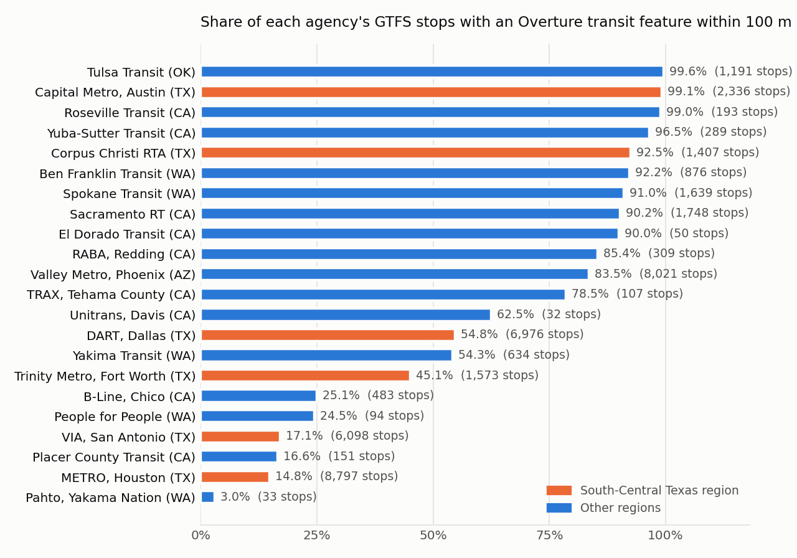
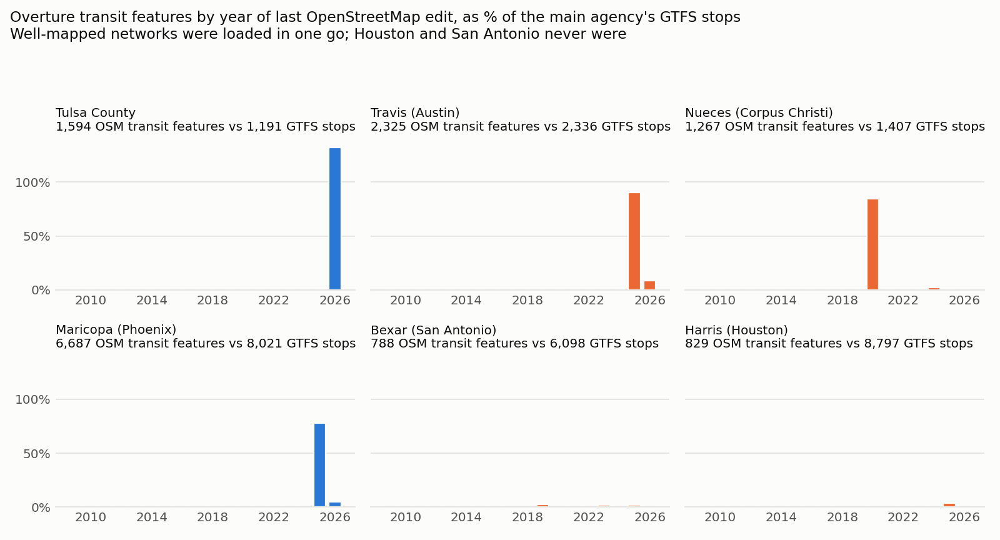

# Best Bias Discovery: whether a bus stop is on the open map depends on which agency runs the bus — Austin's network is 99% mapped, Houston's 15%

> **In three lines.** Houston METRO's bus network is 15% on the open map and Austin's is 99%, in the same state and the same challenge region. Across 22 agencies, which agency runs the bus reaches pseudo-R² 0.363 for which stops are mapped, against 0.043 for every measure of need combined. 130,558 car-free households (at least 230,000 people) in Houston and San Antonio live where most stops are missing, and 5,729 of Houston's missing stops are in the region's most heat-exposed quarter of tracts.
>
> Nothing here is used to compute or calibrate any leaderboard submission.

## The finding in one paragraph

We matched every stop published by twenty-two transit agencies serving the five study regions (43,037 stops, from the agencies' own open GTFS feeds) against the Overture `infrastructure` and `places` layers of the challenge package (release 2026-08-19.0). Whether a stop exists on the open map is decided almost entirely by **which agency operates it**, and the spread is widest inside a single state and a single challenge region: in South-Central Texas, **Austin's Capital Metro is 99% mapped and Corpus Christi's RTA 93%, while Houston METRO is 15% mapped (7,491 of 8,797 stops missing) and San Antonio's VIA 17% (5,055 of 6,098 missing)**. The same split recurs in Northern California: Sacramento RT, Roseville and Yuba-Sutter are 90–99% mapped while Chico's B-Line (25%) and Placer County Transit (17%) are not. In Eastern Washington, **Pahto Public Passage, the free public transit service the Yakama Nation runs, is 3% mapped: none of its 24 stops on the Yakama Reservation are on the map.** Across the 42,854 stops with tract covariates, the operator alone reaches McFadden pseudo-R² 0.363 for which stops are mapped, against 0.043 for car-free share, SVI, rurality and tribal status together, and within each operator a higher share of households without a car does not make a stop more likely to be missing (if anything, the reverse). **130,558 car-free households in Houston and San Antonio, at least 230,567 people,** live in tracts where most of their bus stops are absent from the map.

## Why the automated scorecard cannot see this

The scored coverage gap has no transit term. Overture `infrastructure` is shipped in the package but is not part of any component, and the scorecard's strata (urban/rural, SVI, CVI, tribal, hazard) cannot express "which agency runs the service". The pattern also **reverses under the scorecard's own tribal stratum**: pooling stops by `tribal_any`, tribal tracts look *better* covered (91.4% vs 53.8% of stops mapped within 100 m), because all of Tulsa lies inside the Muscogee (Creek) and Cherokee reservations and Tulsa Transit is almost fully mapped. A tribal/non-tribal ratio therefore hides the one tribal transit system that is missing entirely. And a region-level average for South-Central Texas blends a 99% network with two at 15–17%. Eastern Washington, where the Yakama network sits, is in the package but not in the scored set at all: the challenge page lists the other four regions as the scored tracts, and a submission with 0.5 on its 415 tracts and 0 elsewhere scored exactly the same as all zeros (0.107246299). No number the scorecard produces reflects that region.

**The scorecard's own strata leave nothing behind.** We also asked the leaderboard directly whether the coverage gap
leans along the strata the scorecard reports. Our best open-data estimate of the gap (30 features from roads,
facilities, rurality and region; public RMSE 0.062) predicts, for any 0/1 flag, how the flag should correlate with the
true gap. Submitting the flag alone (one leaderboard row per flag, nothing tract-level returned) measures that
correlation. A departure from the prediction is a bias along that stratum that roads, facilities and region do not
explain. Every flag and its prediction were written down before the score came back (`docs/probe_plan.md`, 23–25 October).

| scorecard stratum (flag) | tracts | departure from prediction | standard errors |
|---|---:|---:|---:|
| SVI ≥ 0.75 | 34% | −0.014 | 1.1 |
| SVI ≤ 0.25 | 19% | −0.020 | 1.5 |
| tribal land | 9% | +0.005 | 0.7 |
| wildfire hazard, top quarter | 24% | −0.021 | 1.8 |
| wildfire hazard, bottom quarter | 25% | +0.012 | 1.0 |
| summer heat days, top quarter | 28% | −0.018 | 1.4 |
| summer drought, top quarter | 25% | +0.015 | 1.2 |
| winter drought, top quarter | 26% | +0.019 | 1.5 |
| climate vulnerability (CVI), top quarter | 26% | +0.039 | 3.0 |
| climate vulnerability (CVI), bottom quarter | 24% | −0.006 | 0.5 |
| any hazard top quarter × SVI ≥ 0.75 | 21% | −0.021 | 1.6 |
| rural × SVI ≥ 0.75 | 5% | −0.008 | 0.6 |
| urban × SVI ≥ 0.75 | 30% | −0.011 | 0.9 |

One cell reaches three standard errors (CVI top quarter). We do not claim it. We had registered that a CVI effect counts
only if the bottom quarter moves the opposite way by two standard errors, and it did not (0.5). We also ran 98 single-flag
probes in total over the competition; with that many, at least one passing three standard errors by chance is about a
one-in-four event (about 5% for the 20 run on 22–25 October). Vulnerable and hazard-exposed tracts are not missing more of
the scored map than their roads, facilities and rurality already imply, and the urban and rural halves of high-SVI tracts
behave the same (−0.011 vs −0.008). The scorecard's strata find no residual bias because the residual bias sits on an
axis they cannot express: who supplied the data.

## Evidence

**Method.** For each GTFS stop (`location_type` 0) inside a tract of the challenge package, we compute the distance (EPSG:5070) to the nearest Overture `infrastructure` feature of class `bus_stop`, `bus_station`, `platform` or `stop_position`, and to the nearest Overture place whose category or name identifies a bus or transit facility. A stop counts as mapped if either lies within 100 m. Overture's `infrastructure` features, transit stops included, are derived from OpenStreetMap (Overture documentation, base theme, https://docs.overturemaps.org/guides/base/infrastructure/), so a stop missing here is missing from OpenStreetMap.

| Agency (region) | GTFS stops in package tracts | Mapped within 100 m |
|---|---:|---:|
| Tulsa Transit (eastern-ok) | 1,191 | 99.6% |
| Capital Metro, Austin (south-central-tx) | 2,336 | 99.1% |
| Roseville Transit (northern-ca) | 193 | 99.0% |
| Yuba-Sutter Transit (northern-ca) | 289 | 96.5% |
| Corpus Christi RTA (south-central-tx) | 1,407 | 92.5% |
| Ben Franklin Transit (eastern-wa) | 876 | 92.2% |
| Spokane Transit (eastern-wa) | 1,639 | 91.0% |
| Sacramento Regional Transit (northern-ca) | 1,748 | 90.2% |
| El Dorado Transit (northern-ca) | 50 | 90.0% |
| Redding Area Bus Authority (northern-ca) | 309 | 85.4% |
| Valley Metro (maricopa-az) | 8,021 | 83.5% |
| TRAX, Tehama County (northern-ca) | 107 | 78.5% |
| Unitrans, Davis (northern-ca) | 32 | 62.5% |
| DART, Dallas (south-central-tx) | 6,976 | 54.8% |
| Yakima Transit (eastern-wa) | 634 | 54.3% |
| Trinity Metro, Fort Worth (south-central-tx) | 1,573 | 45.1% |
| B-Line, Chico (northern-ca) | 483 | 25.1% |
| People for People, rural routes (eastern-wa) | 94 | 24.5% |
| **VIA Metropolitan Transit, San Antonio (south-central-tx)** | **6,098** | **17.1%** |
| Placer County Transit (northern-ca) | 151 | 16.6% |
| **METRO, Houston (south-central-tx)** | **8,797** | **14.8%** |
| **Pahto Public Passage, Yakama Nation (eastern-wa)** | **33** | **3.0%** |

**It is not a matching artefact.**
- The radius does not matter. Overture `infrastructure` alone at 25 / 50 / 100 / 200 m: Houston 5.5% / 6.8% / 8.8% / 12.2%, VIA 8.8% / 11.4% / 13.6% / 16.8%, Austin 94.4% / 97.6% / 99.1% / 99.6%; Pahto is 3.0% at every radius. Only one Pahto stop (a shopping mall in Union Gap, off the reservation) has an Overture stop within 1 km.
- Counting Overture places as well as `infrastructure` raises the low networks by a few points (at 100 m, Houston 8.8% → 14.8%, VIA 13.6% → 17.1%) and changes no ranking; the table uses the combined, higher figure.
- Bexar County, which VIA serves, contains **739** Overture features of class `bus_stop` in total (the edit-year bullet below counts all four transit classes, hence 788 there). Nueces County (Corpus Christi), with about a fifth of Bexar's population, contains 1,261; Travis County (Austin) 2,276; Dallas County 3,569. All come from OpenStreetMap, and the gap is already there upstream: live OpenStreetMap counts of bus-stop nodes (Overpass API, 2026-10-03/04) are 742 in Bexar, 2,279 in Travis, 1,261 in Nueces and 3,562 in Dallas County (with bus platforms), each within a few of Overture's. OpenStreetMap holds **680** `highway=bus_stop` nodes in all of Harris County (Overture: 829 features of the four transit classes), against 8,797 stops on METRO's own feed. Overture is faithfully carrying what OpenStreetMap has; the missing networks were never added to OpenStreetMap. (The live OpenStreetMap counts come from the Overpass API and are not part of the one-command check; the exact queries are in `docs/overpass_queries.md`.)
- **How the mapped networks got there.** Every Overture transit feature in these counties comes from OpenStreetMap, and each carries the time of its last edit. In each well-mapped city, most features share one year, the signature of a bulk import or a bulk clean-up of the whole network: Tulsa County 1,575 of 1,594 in 2026; Travis (Austin) 2,108 of 2,325 in 2025; Maricopa 6,227 of 6,687 in 2025; Nueces (Corpus Christi) 1,192 of 1,267 in 2020; Harris (Houston) and Bexar (San Antonio) have no such year: their 829 and 788 features are spread thinly over 2009–2026, the most in any one year being 331 and 165. The networks that are on the map are the ones someone loaded as a whole; the two that are not have only ever been edited stop by stop. (Last-edit time is not creation time, so a later mass edit can mask an import; it cannot create a burst where nobody touched the network.)

  
- The low networks are ordinary fixed-route systems (no GTFS booking rules; under 2% of stop-times require a call), not demand-response zones. Pahto is also fixed-route (3 routes, 4% of stop-times on call), and its stops sit at the places people travel to: Yakama Indian Health Service, Heritage University, the Yakama Nation Housing Authority, the Cultural Heritage Center, Legends Casino, the Tribal Employment Rights Office.

**Agency, not need, explains which stops are missing.** A stop-level logistic regression (42,854 stops with tract SVI and car-free share) compares the two explanations directly:

| model | predictors | McFadden pseudo-R² | AUC |
|---|---|---:|---:|
| need only | car-free household share, SVI, rural, tribal | 0.043 | 0.637 |
| agency only | 22 operator indicators | 0.363 | 0.868 |
| agency + need | both | 0.374 | 0.879 |

The outcome is 1 if the stop is mapped. The operator alone reaches pseudo-R² 0.363, against 0.043 for everything the scorecard's strata and the household survey can say about need; adding need on top of the operator moves it by 0.011. Within an operator, a higher car-free share slightly *raises* the odds of a stop being mapped (+2.91 log-odds per unit share) and a higher SVI lowers them (−1.19 per unit): inside a city the gap leans a little towards high-SVI tracts, but car ownership does not drive it. Tract by tract (tracts with at least 5 stops), the rank correlation between car-free share and mapped share lies between −0.15 and +0.56 across the 18 operators with at least 10 such tracts. After Benjamini–Hochberg correction for testing 18 operators, none is significant (smallest q = 0.096); the two below p = 0.05 before correction (Sacramento RT +0.24, Redding +0.53) are positive, so car-free tracts are, if anything, better mapped. Houston METRO's service tracts have the highest car-free share of the large networks (9.5% of households) and the lowest coverage.

**Named tracts, all majority-unmapped:**

| city | GEOID | stops | mapped | households | without a car | SVI |
|---|---|---:|---:|---:|---:|---:|
| Houston | 48201422200 | 17 | 6% | 2,619 | 842 (32.1%) | 0.984 |
| Houston | 48201413301 | 20 | 0% | 2,955 | 705 (23.9%) | 0.593 |
| Houston | 48201310300 | 26 | 4% | 2,106 | 632 (30.0%) | 0.768 |
| Houston | 48201312400 | 28 | 4% | 1,030 | 485 (47.1%) | 0.836 |
| San Antonio | 48029141000 | 21 | 0% | 1,300 | 506 (38.9%) | 0.948 |
| San Antonio | 48029110500 | 26 | 23% | 1,115 | 456 (40.9%) | 0.993 |
| San Antonio | 48029160100 | 49 | 6% | 2,372 | 658 (27.7%) | 0.995 |
| San Antonio | 48029170200 | 23 | 4% | 1,833 | 420 (22.9%) | 1.000 |

653 of the 716 tracts with METRO stops, and 269 of the 300 tracts with VIA stops, are majority-unmapped. On the Yakama Reservation, 10 of the 11 tracts with Pahto stops have no mapped stop at all (tracts 53077940001–940003, 53077940005–940008, 53039950103, 53077002104, 53077002201).

## Who is affected and why it matters

- **Scale.** 89,960 car-free households in Houston and 40,598 in San Antonio live in tracts where most of their stops are missing; with Dallas and Fort Worth, 166,048 in South-Central Texas. Counted as people, that is at least 161,300 in Houston, 69,267 in San Antonio and 291,878 across the four networks (ACS table B08201 gives car-free households by household size; households of four or more are counted as four, so these are lower bounds).
- **Heat and climate vulnerability, from the challenge's own strata.** South-Central Texas is one of the challenge's heat regions, and the missing stops sit where the risk is highest. Of Houston METRO's 7,491 unmapped stops, **5,729 are in tracts in the region's top quarter for dangerous-heat days** (`gehe_wbgt30_days_mean`, WBGT above 30 °C) and **4,848 in the top quarter of the Climate Vulnerability Index** (`cvi_overall`); for San Antonio VIA, 2,588 unmapped stops are in top-quarter CVI tracts. Of Austin's stops, which are on the map, none are in top-quarter heat tracts and 1.8% in top-quarter CVI tracts. For households without a car, getting to a cooling centre or clinic during a heat event depends on the bus, and a shelter-access analysis built on the open map sees almost none of these stops.
- **What a "nearest bus stop" query returns.** For a rider standing at a Houston METRO stop, the nearest transit feature on the open map is a median **386 m** away (Austin: 2.5 m); for 48.5% of METRO stops it is more than 400 m, about a five-minute walk, and for 845 stops there is nothing within 1 km. In San Antonio the median is 473 m and 906 stops have nothing within 1 km. Any walk-time or nearest-stop tool built on the open map gives these riders the wrong answer.
- **Named destinations are missing too.** Some stops carry the name of the place they serve. Among Houston METRO's stops named after a hospital or clinic, 7 of 12 are absent from the map, among them `LBJ Hospital` (Harris Health's public safety-net hospital), `VA Hospital` and `MLK Clinic`; 6 of its 6 stops named after a school are absent. For San Antonio VIA it is 4 of 8 medical stops (among them `Eckhert at the Frank Tejeda VA Clinic`) and 18 of 22 school stops, mostly elementary and middle schools (`HEIMER IN FRONT OF COKER ELEM. SCHOOL`). Austin's 2 medical and 11 school stops are all mapped. The counts are small, and taken together these stops are not missed more often than the agency's other stops; the point is what a missing stop is in practice: the bus stop at the county hospital, the VA clinic and the elementary school (`scripts/transit_destinations.py`; street names such as "Veterans Memorial Dr" or "Medical Dr" are excluded, and universities are not counted because "University Blvd" cannot be told apart from a campus by name).
- **Evacuation and relief.** Houston is a hurricane evacuation city, and residents without a car are the ones who depend on public transport to leave or to reach a shelter. When the stops are absent from the base map, coverage maps, walk-time isochrones and "nearest stop" queries understate access.
- **Tribal health access.** Pahto connects reservation communities to the Yakama IHS clinic, the Yakima Valley Farm Workers clinic in Toppenish and Heritage University. An agency that relies on the open map for emergency transport planning on the reservation cannot see the network the Nation itself operates.

## Recommendation

1. Treat transit-stop coverage as a separate component, measured against the agency's own GTFS, not against population or density proxies.
2. For METRO, VIA and Pahto, the fix is an import, not a survey: all three publish open GTFS feeds. A licence-checked import of stop locations into OpenStreetMap would flow into Overture's next release. Austin and Corpus Christi show that the same state, with the same mapping community, reaches 93–99% once that import has happened, and the edit history of each is consistent with a whole-network load (2025 and 2020). Any import has to follow the OpenStreetMap import guidelines (community review, a licence compatible with ODbL).
3. Report coverage per operator. Pooled strata (tribal/non-tribal, urban/rural, region) average a 99% agency with a 15% agency and hide both.

What an import would add, per agency below 60% (stops in package tracts with no Overture transit feature within 100 m; each agency publishes the GTFS feed that fixes it):

| Agency | Stops missing from the map | Coverage today |
|---|---:|---:|
| METRO, Houston | 7,491 | 14.8% |
| VIA, San Antonio | 5,055 | 17.1% |
| DART, Dallas | 3,155 | 54.8% |
| Trinity Metro, Fort Worth | 863 | 45.1% |
| B-Line, Chico | 362 | 25.1% |
| Yakima Transit | 290 | 54.3% |
| Placer County Transit | 126 | 16.6% |
| People for People | 71 | 24.5% |
| Pahto Public Passage (Yakama Nation) | 32 | 3.0% |
| **Total** | **17,445** | |

The data to close the gap already belongs to the agencies and, for Pahto, to the Yakama Nation itself; the decision to publish it into OpenStreetMap, and how, is theirs. The finding gives them the count and the place to start.

## Reproducibility

Code: https://github.com/IwataHiroki0827/bias-bounty-mapping-equity-writeup (public from the day this write-up is posted). GTFS feeds are the agencies' open data; source URLs and retrieval dates per feed are in `data/raw/ext/gtfs/sources.json`.

**One command:** `python scripts/reproduce_discovery.py` downloads what is missing, rebuilds every table and then recomputes the 58 headline numbers of this write-up (stop counts and coverage per agency, county bus-stop counts, car-free households and people, stops named after hospitals and schools, the three pseudo-R² values, the edit-year bursts, the climate-risk counts, the nearest-stop distances) and checks each against the value printed here (50 checks at the time of the 7 October clean run, 58 now): `PASS` / `FAIL`, exit code 0 only if all match. The GTFS files' SHA-256 are recorded in `docs/discovery_manifest.json`; if an agency has since published a new feed, the check says so, so a drifted number can be told apart from a broken pipeline. This has already happened once: a run from a fresh clone and environment on 7 October passed 48 of the 50 checks and reported that three agencies had published new feeds; the two misses were Redding's coverage, whose new feed has 268 stops instead of 309 (88% mapped instead of 85%), and the tribal / non-tribal rate that includes it (0.537 instead of 0.538). No conclusion changes. A second run, from a fresh clone of the public repository on 27 October, passed 45 of the 58 checks: ten of the 22 feeds had been republished since retrieval, every miss traces to one of those ten, and the twelve unchanged feeds reproduce every number exactly. The largest moves are Houston METRO (8,803 stops instead of 8,797, still 15% mapped; 90,075 car-free households in majority-missing tracts instead of 89,960) and Redding (256 stops, 90% mapped). No conclusion changes; that run took about four minutes. Tested with Python 3.12, DuckDB 1.5.6, pandas 2.2.3, scikit-learn 1.6.1, SciPy 1.14.1 (pinned in `requirements.txt`); CPU only, about 15 minutes, most of it remote DuckDB reads.

- Challenge data: Overture `infrastructure` and places (the package's `overture-pois` files; release 2026-08-19.0), `strata/<region>/<region>-census-tracts.parquet` and `<region>-strata-tract-table.parquet`, read remotely from Source Cooperative with DuckDB.
- Additional public data (Best Bias Discovery only), retrieved 2026-10-02 to 2026-10-05:
  - GTFS feeds via the Mobility Database catalogue (`https://files.mobilitydatabase.org/feeds_v2.csv`): Valley Metro `mdb-147`, VIA `tld-217`, Tulsa Transit `tld-235`, TRAX `mdb-116`, Houston METRO `mdb-2060`, DART `mdb-152`, Capital Metro `mdb-150`, Trinity Metro `mdb-885`, Corpus Christi RTA `mdb-315`, Sacramento RT `mdb-2137`, Roseville Transit `mdb-1067`, Unitrans `mdb-82`, Yuba-Sutter Transit `mdb-79`, Placer County Transit `mdb-77`, El Dorado Transit `mdb-75`, Redding Area Bus Authority `mdb-3031`, B-Line `ntd-90208`, and the agencies' own URLs for Spokane Transit, Yakima Transit, Ben Franklin Transit, Pahto Public Passage and People for People (exact URLs and byte counts in `data/raw/ext/gtfs/sources.json`).
  - ACS 2020–2024 5-year table B08201 (households by vehicles available), table-based summary file `acsdt5y2024-b08201.dat` from www2.census.gov.
- Scripts: `scripts/discovery_transit.py` (download, first match), `scripts/discovery_transit_robust.py` (distances, radius sensitivity, feed profiles), `scripts/fetch_acs_vehicles.py`, `scripts/transit_summary.py`, `scripts/transit_examples.py`, `scripts/discovery_transit_model.py` (agency vs need regression), `scripts/discovery_transit_history.py` (source and last-edit year of Overture transit features by county).

## Objections we anticipated

**"Transit is not part of the coverage gap, so this is out of scope."** The challenge asks whether the open map serves the communities most exposed to climate risk, and the package ships Overture's `infrastructure` layer for exactly this kind of question. The point is that the scorecard's three components cannot see the gap at all: a tract in Houston with a 0% mapped bus network can score a coverage gap of 0. A bias the metric is blind to is the kind the bounty asks for.

**"Missing stops do not stop anyone riding the bus."** Riders who know their route do not need the map. Planners, relief agencies and routing tools do: walk-time-to-transit, evacuation pickup planning and "nearest stop" queries built on the open map return nothing for these neighbourhoods. The harm is to every analysis and service built on top of the map, which is how the challenge frames coverage.

**"Everyone in OpenStreetMap knows imports matter."** That imports raise coverage is known. That an agency's data decides whether its stops reach OpenStreetMap has precedents: in Florida in 2010–11, four agencies' stops were uploaded while Sarasota's could not be, because of problems in its GTFS file and staff turnover (https://wiki.openstreetmap.org/wiki/FL_Bus_Stops). What we did not find in prior work is the test that coverage is unrelated to need; the audits of open map data we found concern buildings, against wealth, population density and urban/rural share (Gevaert, Buunk and van den Homberg, IEEE JSTARS 17, 2024, four building datasets including Overture and OpenStreetMap). Beyond that, what the challenge's tooling cannot show is the size (99% vs 15% in one region), that it follows the operator and not need, and that the unloaded networks belong to the fourth- and seventh-largest US cities. Reading edit dates from Overture's `sources` is not new here (thread 34972, stale roads); applying it to transit against each agency's own GTFS is. Thread 35154 finds a pattern of the same shape for dialysis facilities (independent units hidden far more often than chain units, while geography and SVI are null); we read that as support for the general claim, that who supplies the data decides coverage. Our contribution is the transit case, with the supplier identified for 22 networks and the mechanism (one bulk import, or none) dated from Overture's own edit history.

**"The heat numbers just reflect Houston's climate."** Partly: the point is that the most heat-exposed large city is the one whose stops the map lacks, so heat-response analysis on the map is wrong where it matters most.

**"The edit-year bursts could be a later bot or clean-up, not an import."** Possible: last-edit time is not creation time. But a bulk clean-up still requires the stops to be there, and the decisive evidence does not depend on the bursts: OpenStreetMap holds 680 bus stops in all of Harris County against 8,797 on METRO's feed, while Travis County holds 2,279 against Capital Metro's 2,336. Whatever the edit history, the Houston network was never added.

**"A 100 m radius is generous; dense downtowns could match the wrong feature."** It can only inflate coverage, never hide it. The low networks stay low at every radius (`infrastructure` alone: Houston 5.5% at 25 m to 12.2% at 200 m), and the high ones are already high at 25 m (Austin 94.4%).

**"Car-free households are not people."** Correct: ACS B08201 counts households. Where we give people, we use the same table's split by household size and count households of four or more as four, so the people counts are lower bounds.

## Limitations

- GTFS is the agency's own record, not ground truth; a few stops may be seasonal or temporarily closed. Feed service windows: all feeds cover October 2026 except TRAX (to 2026-05-01), Corpus Christi RTA (the latest catalogue copy covers May 2025) and Sacramento RT (the latest catalogue copy covers January–April 2025); all three are kept and flagged, and all three are high-coverage, so they do not drive the finding. Placer County Transit's feed ends on 2026-10-01. DART's feed is a two-week window (2026-10-04 to 10-18) of the current network.
- GTFS feeds contain errors: 21% of 632 US feeds had at least one validator error, the most common in route-shape distances (Devunuri and Lehe, *Findings*, 2024, https://findingspress.org/article/116694-a-survey-of-errors-in-gtfs-static-feeds-from-the-united-states).
- Licences. US agencies publish GTFS under a mix of open licences, agency terms and no stated terms; every feed here is a public download without registration, and the repository downloads them rather than redistributing them. The terms we found are listed per feed in `docs/gtfs_licenses.md`. The conclusion does not rest on the feeds without stated terms: on the seven feeds with stated terms (METRO, VIA, Capital Metro, Valley Metro, Corpus Christi RTA, Sacramento RT, Roseville; 28,453 stops) the operator reaches pseudo-R² 0.440 against 0.030 for need, and without VIA, whose terms limit use to helping riders or promoting public transport, 0.453 against 0.018. Attribution as the agencies require: Data is provided by permission of The Metropolitan Transit Authority of Harris County, Texas. Data provided by VIA Metropolitan Transit. Data provided by Trinity Metro is not warranted by Trinity Metro for accuracy or completeness and data is subject to change without notice.
- We count a stop as mapped if any Overture transit feature lies within 100 m; this can only overstate coverage.
- Operator: Pahto Public Passage is provided by the Yakama Nation (Yakama Nation Tribal Transit, created in 2007 under the Nation's Economic Development programme; https://www.pahtotransit.com/contact.php, https://yakamaecondev.com/pahto-transit/, retrieved 2026-10-02).
- Only agencies with an open GTFS feed are covered. Eastern Oklahoma's tribal transit programmes publish no feed we could find, so the tribal comparison rests on one Nation's service.
